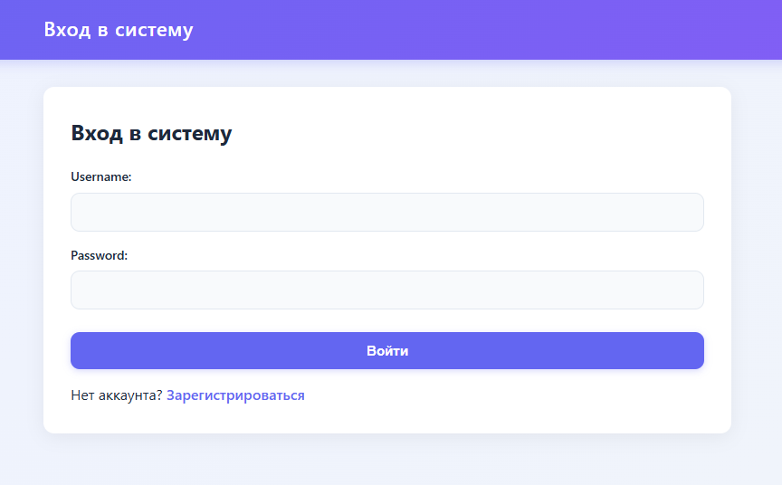
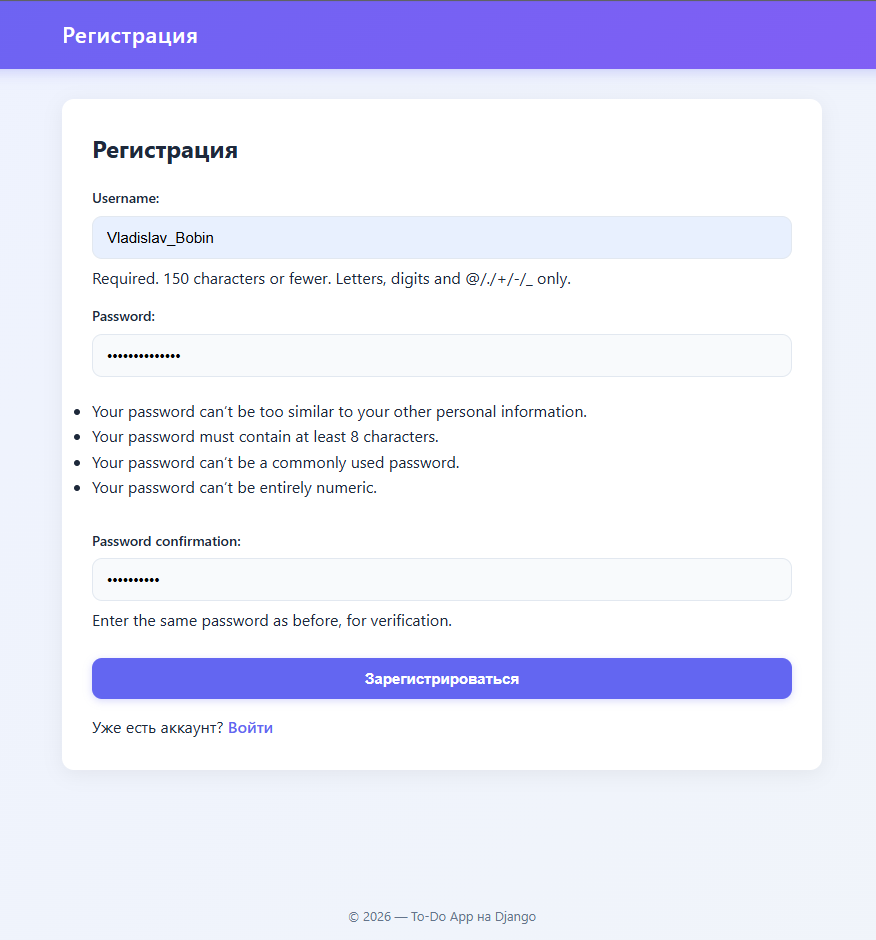
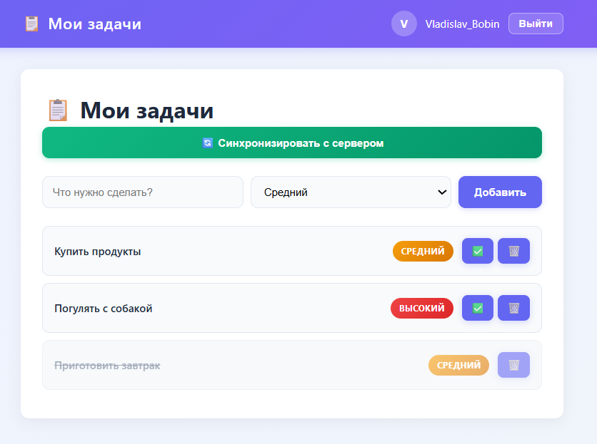

# 📋 To-Do App на Django

Многопользовательское веб-приложение для управления задачами с авторизацией, синхронизацией с внешним API и современным интерфейсом.


---

## ✨ Возможности

- 🔐 Регистрация и авторизация пользователей (встроенная система Django).
- 👤 Каждый пользователь видит только **свои** задачи.
- ✅ Создание, выполнение и удаление задач.
- 🎨 Современный адаптивный интерфейс (градиенты, анимации, mobile-friendly).
- 🔄 Синхронизация задач с внешним API (с retry-логикой и обработкой ошибок).
- 📊 Восстановление после сбоев (флаг `synced` в БД).
- 🛡️ Защита от CSRF-атак, дубликатов задач и доступа к чужим задачам.
- 💬 Уведомления через Django Messages Framework.

---

## 🛠️ Стек

- **Backend:** Python 3.12, Django 5.0
- **База данных:** SQLite (встроенная в Django ORM)
- **Frontend:** HTML5, CSS3 (адаптивная вёрстка, flexbox, анимации)
- **Внешние API:** JSONPlaceholder (POST), Adviceslip (GET)
- **Библиотеки:** `requests` (работа с API)

---

## 🚀 Установка и запуск

### 1. Клонируйте репозиторий
```bash
git clone https://github.com/<ваш_username>/todo_app.git
cd todo_app
```

### 2. Создайте виртуальное окружение
```bash
python -m venv venv
```

Активируйте его:
- **Windows:** `venv\Scripts\activate`
- **Mac/Linux:** `source venv/bin/activate`

### 3. Установите зависимости
```bash
pip install -r requirements.txt
```

### 4. Примените миграции
```bash
python manage.py migrate
```

### 5. Создайте администратора (опционально)
```bash
python manage.py createsuperuser
```

### 6. Запустите сервер
```bash
python manage.py runserver
```

Откройте в браузере: [http://127.0.0.1:8000/](http://127.0.0.1:8000/)

---

## 📁 Структура проекта

```
todo_app/
├── manage.py
├── requirements.txt
├── .gitignore
├── README.md
├── todo_web/              # Настройки проекта
│   ├── settings.py
│   ├── urls.py
│   └── ...
├── tasks/                 # Приложение задач
│   ├── models.py          # Модель Task (ORM)
│   ├── views.py           # Логика (CRUD, авторизация, синхронизация)
│   ├── urls.py            # Маршруты приложения
│   ├── admin.py           # Настройки админки
│   ├── templates/
│   │   └── tasks/
│   │       ├── base.html  # Базовый шаблон (каркас)
│   │       ├── index.html # Список задач
│   │       ├── login.html
│   │       └── register.html
│   ├── static/
│   │   └── tasks/
│   │       └── style.css  # Стили
│   └── migrations/
└── api_client.py          # Модуль работы с внешним API
```

---

## 🧠 Как это работает

1. **Модель `Task`** связана с `User` через `ForeignKey`. Каждая задача принадлежит одному пользователю.
2. **View** защищены декоратором `@login_required` — анонимные пользователи перенаправляются на страницу входа.
3. **Синхронизация:** при нажатии кнопки `sync_tasks` выбираются задачи с `synced=False`, отправляются на API. При успехе флаг обновляется на `True`.
4. **Защита от сбоев:** если API недоступно, `synced` остается `False`, и при следующей попытке задача отправится снова.
5. **Изоляция данных:** все запросы к БД фильтруются по `user=request.user`, чтобы пользователь не мог изменить/удалить чужие задачи.

---

## 📸 Скриншоты

### Окно входа:


### Окно регистрации:


### Окно списка задач:


---

## 📝 Лицензия

Этот проект создан в учебных целях. Свободен для использования и модификации.

---

## 👨‍💻 Автор

**Бобин Владислав Алексеевич**
- GitHub: [@BobinVladislavv](https://github.com/BobinVladislavv)
- Email: vlad.bobin17@gmail.com